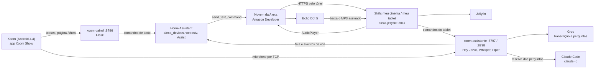

# Como as peças se integram

Echo Dot 5, Home Assistant, Amazon Developer, tablet Xoom e Claude Code trabalham juntos: um notebook Linux na rede de
casa concentra os serviços, o tablet é a tela e o microfone, e o Echo é o alto-falante.



## Os caminhos principais

**Tocar e controlar música.** Toque na tela → `POST /show/echo/<ação>` → Home Assistant envia o texto ao Echo com
`alexa_devices.send_text_command` → a nuvem da Alexa chama a skill → a skill responde com `AudioPlayer.Play` e uma URL
assinada por 12 h → o Echo baixa o MP3 pela skill, que busca no Jellyfin. O app não fala direto com o Echo.

**Estado na tela.** O Echo avisa a skill de cada evento (`PlaybackStarted`, `PlaybackStopped`...). A skill grava a fila em
`~/.alexa-jellyflix-filas.json`, e o painel lê esse arquivo em `/show/echo/estado`.

**Letra em tempo real.** A posição é estimada a partir da hora do `PlaybackStarted` e do offset do `PlaybackStopped`, porque
o Echo não informa a posição continuamente. A letra vem primeiro do Jellyfin (embutida na faixa) e depois do
[LRCLIB](https://lrclib.net), com cache em `painel/letras/`. O resultado do LRCLIB só é sincronizado se a duração da faixa
bater em até 5 s; senão a letra aparece parada. O ajuste de ±0,5 s da tela vale para todas as faixas.

**Voz no tablet.** "Hey Jarvis" → transcrição pela Groq (`whisper-large-v3`, com faster-whisper local de reserva) →
`comandos.py` → Assist do Home Assistant → pergunta geral na Groq, com `claude -p` de reserva. A resposta sai no Echo,
e a tela mostra o texto.

**Voz no Echo.** A skill "meu tablet" recebe "Alexa, pede pro meu tablet...", e `alexa-tablet.js` repassa ao
xoom-assistente em `127.0.0.1:8798/comando`.

## Amazon Developer

1. Em [developer.amazon.com/alexa/console/ask](https://developer.amazon.com/alexa/console/ask), crie duas skills em
   português (Brasil) com modelo próprio e hospedagem própria.
2. Cole no JSON Editor `alexa/modelos/meu-cinema-pt-BR.json` em uma e `alexa/modelos/meu-tablet-pt-BR.json` na outra.
3. Na skill "meu cinema", ative a interface **Audio Player**.
4. Nas duas, use o endpoint `https://SEU-DOMINIO/api/jellyflix`, com o tipo de certificado que corresponde ao seu domínio.
   O mesmo processo atende as duas e separa pelo `applicationId`.
5. Copie os IDs para `ALEXA_SKILL_ID_JELLYFLIX` e `ALEXA_SKILL_ID_TABLET` e deixe as skills em **Development**.

Lição aprendida: em pt-BR, a invocação precisa ser feita de palavras comuns. "jellyflix" funcionava no simulador, mas não
por voz; "meu cinema" funciona.

**Segurança:** o túnel deve liberar só `/api/jellyflix`. Cada pedido tem a assinatura da Amazon e o ID da skill conferidos,
mas não há filtro por conta. Não publique na loja de skills apontando para o seu servidor, porque qualquer pessoa poderia
usá-la.

Exemplo de `cloudflared`:

```yaml
ingress:
  - hostname: seu-dominio.exemplo
    path: ^/api/jellyflix
    service: http://127.0.0.1:3011
  - service: http_status:404
```

## Home Assistant

Integrações usadas: **Alexa Devices** (`alexa_devices`), **LG webOS TV**, previsão do tempo e **Assist**. Crie um token de
longa duração para `HA_TOKEN`.

| Entidade ou serviço | Uso |
|---|---|
| `alexa_devices.send_text_command` | comandos para o Echo |
| `notify.echo_dot_de_rodrigo_speak` | fala no Echo; o `device_id` é descoberto a partir dela |
| `media_player.echo_dot_de_rodrigo` | volume atual |
| `sensor.echo_dot_de_rodrigo_temperatura`, `_next_alarm`, `_next_reminder` | dados na tela |
| `event.echo_dot_de_rodrigo_voice_event`, `event.tv_voice_event` | comandos com "tablet" e repetição das respostas |
| `weather.forecast_casa` | previsão do tempo |
| `binary_sensor.xoom_show`, `binary_sensor.movimento_garagem`, `sensor.xoom_tempo_resposta` | criadas pelo projeto via API |

Troque os nomes no topo de `painel/show_xoom.py` e `assistente/assistente.py` pelos do seu Echo.

Se a Alexa não preencher o texto do comando no evento de voz, crie uma Rotina com a ação "Alexa diz: ... no tablet".

## Tablet Xoom

Motorola Xoom Wi-Fi com ROM Android 4.4.4, root e ADB por rede. Sem NEON, o Chromium 49 é o teto do navegador; por isso os
apps são Java puro e o vídeo abre no MX Player.

| App | Pacote | Função |
|---|---|---|
| `app/` | `br.xoomshow` | WebView do `/show`, microfone, início no boot |
| `app-jellyfin/` | `br.jellyxoom` | Jellyfin leve em 480p e TV ao vivo |
| `app-youtube/` | `br.ytxoom` | YouTube pelo notebook com yt-dlp |

O app Xoom Show é só uma casca: **mudanças em `painel/show.html` não pedem APK novo**, basta reabrir o app.

Na TV ao vivo, o app só mostra canais com número, que na instalação original são os das fontes gratuitas. O Jellyfin
converte o canal para HLS em 480p.

`vigia/vigia-xoom.sh` roda no cron a cada 2 minutos: reconecta o ADB, reabre o app parado ou travado e publica
`binary_sensor.xoom_show`. Defina `VIGIA_AVISO_CMD` para receber alertas.

## Claude Code

O Claude Code aparece em dois papéis:

- **Em execução:** `comandos.py` usa `claude -p --model haiku` como reserva para perguntas gerais. O login do CLI precisa
  estar feito no notebook, e o `ANTHROPIC_API_KEY` não é usado.
- **Na construção e operação:** o projeto foi desenvolvido e mantido em conversas com o Claude Code no próprio notebook,
  usando ADB no tablet, as APIs do Home Assistant e do Jellyfin, e PM2. Exemplos do tipo de pedido que funcionou:
  "instale a atualização do APK no tablet" e "implementa a letra em tempo real no Xoom".

Para adaptar à sua casa, abra o Claude Code na pasta do repositório e peça para ajustar endereços e entidades.

## Serviços no notebook

```sh
pm2 start painel/xoom_painel.py --name xoom-painel --interpreter python3
pm2 start assistente/assistente.py --name xoom-assistente --interpreter assistente/venv/bin/python
pm2 start painel/movimento_garagem.py --name movimento-garagem --interpreter assistente/venv/bin/python
pm2 start alexa/alexa-jellyflix.js --name alexa-jellyflix
```

`.env.exemplo` lista as variáveis. A skill lê `alexa/.env`; o painel e o assistente leem `~/.env`.

## Situação dos testes

| Parte | Situação |
|---|---|
| Tela de música e letra em tempo real | vistas funcionando no Xoom; sincronia fina ainda sem avaliação de ouvido |
| Comandos da tela para o Echo | testados no Echo real por texto |
| Skill "meu tablet" | testada no simulador; falta teste completo por voz no Echo |
| TV ao vivo no app Jellyfin | pedido ao servidor testado em canais Pluto, Plex e abertos; falta testar a reprodução no tablet |
| Testes automáticos da skill | `cd alexa && npm install && npm test` (9 testes) |
